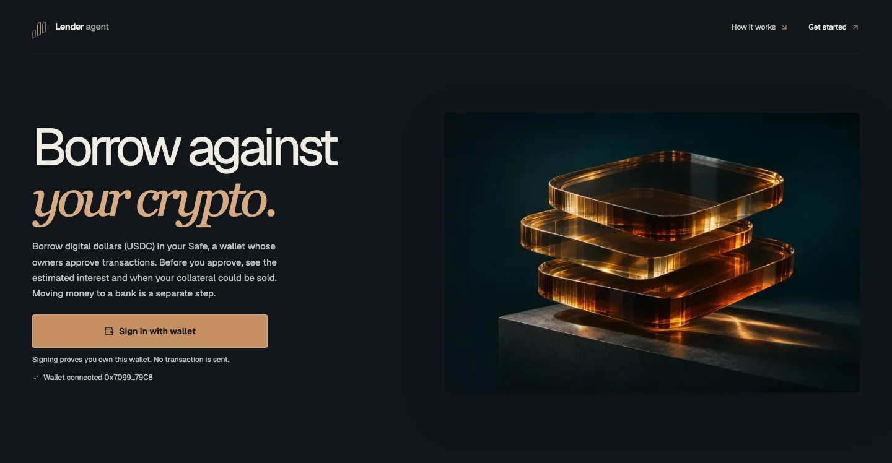
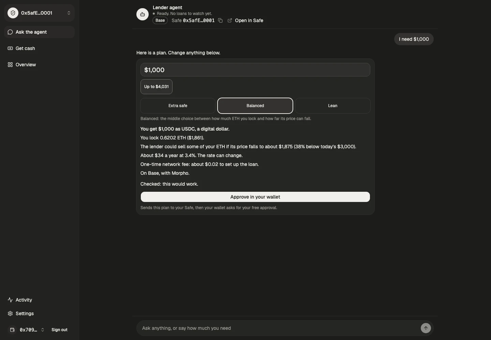

# Lender agent

Lender agent is an open-source loan management app for Safe multisig wallets. The web app helps owners inspect supported lending positions, ask questions, prepare loan proposals, and review transactions that require Safe owner signatures. Lending is currently served on Base and Arbitrum; Safe setup is available on a broader set of networks, which does not mean lending is supported there. The repository also retains an older Vite mockup as a separate demo; it is not the production app.

> **Status:** This is software that can interact with smart contracts and third-party services. The repository does not promise that a market, quote, transaction, or worker is available or suitable for your situation. Review every transaction in your Safe and verify the supported network and market before signing. Production deployment requires operator configuration and security review.

## Screenshots

These screenshots were captured from the local mock app with synthetic borrower data. They do not show live balances or a live integration; the quote is illustrative and not an available offer.





## Run the local mock

Requirements: Node.js 24 and pnpm 10.0.0 (the repository pins `pnpm@10.0.0` in `package.json`). Clone this public repository, install dependencies, and start the Next.js app in mock mode:

```sh
git clone https://github.com/dennisonbertram/lender-agent.git
cd lender-agent
pnpm install --frozen-lockfile
pnpm mock dev
```

Open <http://localhost:3000>. The mock command clears inherited database, model, email, fork, and signer credentials, and sends configured RPC and Safe service URLs to a closed local port before Next.js loads `.env*` files. It uses in-memory PGlite, scripted chat, local email recording, and fixture services without editing `.env.local`. The dedicated local-demo entrypoint selects its own bundled Anvil test wallet through wagmi and leaves any browser extension untouched; wallet-to-Safe transfers are unavailable because this demo does not simulate them. Other mock proposal actions use fixture behavior and do not represent live transactions. See [the runbook](docs/RUNBOOK.md) for setup and operational details.

## Repository layout

- `apps/web/` is the Next.js application, API, database layer, and worker.
- `src/` is the retained Vite mockup with sample data and scripted responses.
- `docs/` contains product, implementation, and operational documentation.

Useful commands from the repository root:

```sh
pnpm mock dev    # Next.js app with local fixtures
pnpm demo:dev     # separate Vite mockup
pnpm typecheck
pnpm test         # mockup and web-app tests
pnpm build        # production build of the web app
pnpm start        # serve the production build
```

The app can run in real-service mode, but configuration does not make every optional feature production-ready. The default relayer does not sponsor Safe deployment; when sponsorship is unavailable, the connected user wallet sends the deployment transaction and pays its network fee. The Reserve executor KMS signer is a stub and cannot sign real Reserve transactions. The standalone worker and scheduled worker route are separate operating modes; configure only one for each deployment. Read the [runbook](docs/RUNBOOK.md) and review the code before connecting production credentials or wallets.

## License and policies

The original project code in this repository is licensed under the [MIT License](LICENSE). Third-party packages remain under their respective licenses; see their package and license metadata.

- [Terms of Service](https://ai-loan-agent-mu.vercel.app/terms)
- [Privacy Policy](https://ai-loan-agent-mu.vercel.app/privacy)
